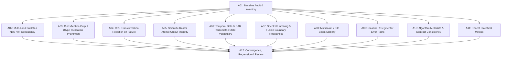

# Task Graph & Dependency Order — R12-A Science Numerics

## Work Packages
- **A01**: Baseline numerical defect list & duplicate implementation audit (Compare against #1479).
- **A02**: Multi-band NoData, NaN, and Inf rules consistency across segmentation, classification, and indices.
- **A03**: Classification output dtype never silently truncated (support >255 uint16, >65535 uint32, signed int32, overflow rejection).
- **A04**: CRS transformation failures must fail closed (reject failed `OGR_G_Transform`, never pass invalid geometry to GDAL).
- **A05**: Scientific raster output atomic write / stage-rename integrity in `rs_segment_map.cpp`.
- **A06**: Temporal cube scene read exception attribution & uint64 overflow prevention; SAR radiometric state vocabulary.
- **A07**: Spectral unmixing, PCA, SAM, SID, pansharpening ill-conditioned matrix & non-finite guards.
- **A08**: Multiscale tile seams, buffer/halo stability, rotated affine & negative pixel size handling.
- **A09**: Classification & segmentation error paths: `scaler.fit` failure checks, feature dimension verification in statistical classifier.
- **A10**: Manifest and algorithm metadata contract consistency.
- **A11**: Scientific metrology honesty: confusion matrix zero-division guard, invalid sample exclusion.
- **A12**: Full Catch2 regression suite, performance benchmark validation, dual independent reviews, PR generation.
