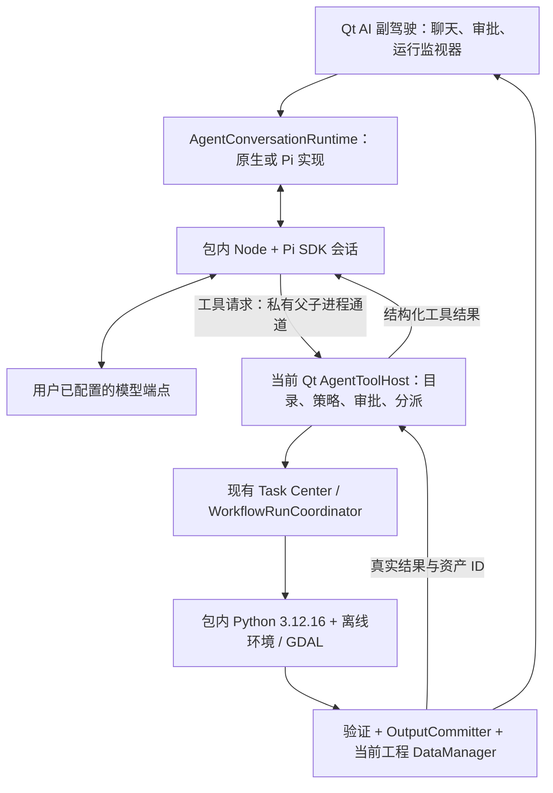

# Vendored Pi 产品内 Agent 实施方案

日期：2026-11-15。状态：实施建议，尚未实施。代码基线：`master@8d36bfd243476a445a89551d4fa18b5f7a0b5e9f`。

本文将用户所说的“项目的 agent”解释为 Windows 产品内的 AI 副驾驶，沿用现有模型设置、审批、任务中心和结果资产界面。目标是把 Pi 随应用交付，并由 Pi 接管通用模型循环；首版继续通过原生宿主执行 Python，Shell 后续单独设计。

## 1. 建议与范围

建议采用 **包内 Node + 受控 Pi SDK 子进程 + 当前 Qt 工具宿主**。Qt 不嵌入 Node，不把 Pi 终端界面嵌入产品，也不让产品用户安装 Pi、Node 或 npm 包。

Pi 负责模型请求、流式回答、通用工具调用循环和对话上下文。Qt 负责模型配置与凭据持久化、中文/英文控件、工作区访问策略、审批、任务执行、取消、结果验证与资产交付。科学领域的预算、预检、计划验证、恢复和审计继续属于原生科学会话模块。

首版范围：一个对话对应一个 Pi 会话；同一轮只启用一个通用 agent 引擎；由新宿主强制同一工程只有一个有副作用的 Agent 会话。现 `pi/roles/README.md` 的单写者要求是角色约定，不能当作已经存在的工程锁；P2 才实施这项宿主约束。正常人工算法任务仍由既有 Task Center 调度。复用 Python 3.12.16、离线科学依赖及 GDAL，不增加另一套 Python；不启用 Pi 自带 Shell、通用文件读写、任意扩展或 Codemode。

**MVP 完成标准不是“Pi 能回答一句话”，而是随包 Pi 能通过当前 GUI 的审批和 Task Center 调用随包 Python，产出经物理校验的 NDVI 掩膜，并在同一 GUI 的 DataManager、结果卡与地图中交付。**

## 2. 当前项目的事实与缺口

| 已有内容 | 代码证据 | 对方案的含义 |
| --- | --- | --- |
| 外部 Pi 扩展与成熟 MCP 桥 | `pi/README.md`、`pi/exp-rs-spatial.ts`、`pi/mcp_bridge.ts:360` | 可以复用工具名映射、schema 漂移和取消测试；不等于产品已 vendor Pi |
| 产品聊天循环仍在 QWidget 内 | `src/agent/agent_copilot_dock_widget.h:145`；`.cpp:602,935,1039` | Dock 直接持有 `LlmStreamingClient`、历史和手工 follow-up，需要迁出通用循环 |
| GUI 共享工程执行与资产实例 | `src/app/main_window_docks.cpp:803`；`agent_copilot_dock_widget.cpp:208` | Pi 的工具必须回调这一宿主，不能另起执行权威 |
| 独立 `--mcp` 使用另一套内存实例 | `src/app/main.cpp:264` 的分支创建 `mcpDataManager`，且不注册 GUI-only 工具 | 直接沿用现 Pi 扩展会把任务和资产交给第二进程；共享工作目录不能解决此问题 |
| 原生审批与事务交付已打通 | `copilot_tool_gate.h`、`ToolCallDispatcher`、`OutputCommitter` | 承接 Pi 请求即可，不能重写另一套执行器或让审批后的 Python 走旁路 |
| 科学会话已有领域状态机 | `src/agent_loop/scientific_agent_session.*`、AgentOps、ADR 0175 | 与通用 LLM 循环职责不同，迁移 Pi 时保留 |
| 模型设置、密钥存储、双语界面已有实现 | `llm_config_manager.h`、`application_language.cpp`、`docs/i18n.md` | 不创建第二套用户 provider/auth 配置；保持语言重启生效 |
| Python 已有可搬迁的锁定与离线交付模式 | `vendor/python/`、`scripts/prepare_python_runtime.py`、`cmake/PythonRuntime.cmake` | Pi 与 Node 复用其供应链和安装验证强度 |

现有 `pi/README.md`、ADR 0122 中“Pi 不支持 MCP”的上游描述已经过时：当前官网明确提供内置 MCP 与 Codemode。实施时更新当前使用文档，并给历史 ADR 添加后续决策引用，不把历史假设当作现行接口约束。[Pi 当前说明](https://pi.dev/)

## 3. 上游选择与 vendor 定义

本轮核实的候选是 `earendil-works/pi` 的 **1.5.2**，固定提交 `b4afdddf44e059c67ccf5097e5317d913521b470`。这只是待兼容验证的候选锁，不是宣称已打包通过。上游要求 Node >= 22.19.0；建议首发验证 Node **24.22.3 LTS / Windows x64**。其官方 ZIP SHA-256 为 `e612af99f626ab415ea225af6bce5c971feb448cb5cae250bb1c3fa50c5f7d9f`。[Pi 上游](https://github.com/earendil-works/pi)、[Node 官方版本索引](https://nodejs.org/dist/index.json)、[24.22.3 校验清单](https://nodejs.org/dist/v24.22.3/SHASUMS256.txt)

| 接入方式 | 得失 | 本项目决策 |
| --- | --- | --- |
| 启动原版 Pi CLI / TUI | 接入快，但带来默认工具、配置发现、资源加载和 CLI 协议耦合 | 不作为产品首选 |
| 原版 Pi RPC | 官方支持非 Node 客户端；仍需严格控制其工具和资源，并把执行接回 Qt | 作为 P0 对照，不直接调用现外部扩展 |
| Pi SDK + 产品自有 Node wrapper | 可以显式注入模型、工具、资源与会话，并把上游事件转换为稳定的产品事件 | 首选，需先通过受控配置与 Windows 依赖闭包验证 |
| `pi-agent-core` + `pi-ai` | 依赖较小、没有完整 CLI 的资源发现；不等于自动获得完整 SDK 的会话压缩与持久化 | P0 的明确备选；若采用，需重新列出缺失能力，不能声称已包含完整 Pi 会话能力 |

完整 SDK 默认会创建资源加载器、文件配置和持久会话，不能直接使用无参数 `createAgentSession()`。SDK 提供覆盖这些依赖的接口；CLI 默认的 MCP/Codemode 扩展也不等于 SDK 必然自动启用。必须按固定版本源代码配置并测试，而不是靠系统提示要求模型“不要用 bash”。[SDK 会话与配置](https://github.com/earendil-works/pi/blob/b4afdddf44e059c67ccf5097e5317d913521b470/packages/coding-agent/docs/sdk.md)

**已确认的 P0 缺口：1.5.2 的公开 `ModelRuntime` 没有透传下层 `AuthContext`。** 即使使用内存凭据，注册 provider 后的可用性刷新仍可能探测其它内置 provider 的环境或用户凭据文件。因此不能宣称原样 SDK 已完全关闭环境认证发现。建议保留一个小 vendor 补丁，把 `AuthContext` 透传到下层 `createModels`，在产品实现中禁用 ambient env/file 探测，并评估增加内置 provider allowlist；补丁须有负例测试和上游提案。P0 不通过时不扩大到产品接入，改选 agent-core 或另一个已验证版本的决定需要显式记录。

1.5.2 下建议核验并固定的配置如下；这些是实施要求，尚未作为本项目运行验证：

| 项目 | 明确配置 / 处理 |
| --- | --- |
| 凭据 | 公开 `InMemoryCredentialStore` 来自 `pi-ai`；1.5.2 不从 SDK 顶层导入未导出的 `AuthStorage` |
| 模型运行时 | `modelsPath:null`、`modelsStore:new InMemoryModelsStore()`、`allowModelNetwork:false`、`refreshOnCreate:false`；完成上述 AuthContext 透传补丁 |
| 资源 | 自定义空 `ResourceLoader` 后只注入随包资源；不只设置 DefaultResourceLoader 的若干 noFlags |
| 设置与会话 | `SettingsManager.inMemory(...)`、`SessionManager.inMemory(cwd)` 起步；后续存储只进入产品专有目录 |
| 工具 | 明确 host 自定义工具 allowlist；排除 `read/bash/powershell/edit/write/grep/find/ls`、`mcp__*`、`codemode`、`tool_search` |
| 输入扩展 | `prompt(...,{expandPromptTemplates:false})`；验证扩展命令、skill/template 不被隐式执行 |
| 附加行为 | `cacheWarming:'off'`、`enableInstallTelemetry:false`、`enableAnalytics:false`、`PI_TELEMETRY=0`；不注册 Codemode（其 mode 没有 off 值）；初版关闭自动 session retry，显式 `retry.provider.maxRetries:0` 并单测请求次数 |

不启用工具不代表其包可以随意从依赖树删除。完整 SDK 的 native/WASM/动态加载资源仍需按实际闭包交付；`pi-durable` 虽是上游独立包，但不能无依据把它列为本 SDK 的强制依赖。详细公开接口与源码证据见本轮上游研究记录。

本项目 vendor 的含义：Git 保留精确版本、源码 SHA、依赖锁、许可证、构建配方及必要补丁；大归档进入受控构建缓存或制品镜像；已准备的完整 Node/JS/资源闭包随应用交付。这与 `vendor/python/README.md` 的模式一致。只有 `package.json`、一个安装 URL 或开发机全局 `pi` 不算完成 vendor。

禁止发布跟随 `main`/`latest` 的依赖；npm 顶层包版本固定也不能替代传递依赖锁。准备阶段显式获取与验证，产品启动及离线打包阶段零下载。上游源码快照、各 npm tarball integrity、Node 归档与最终 payload 清单分别记账。

## 4. 推荐架构与职责

### 小接口与唯一执行路径

新增一个真实可替换的对话接口，提供 `startSession`、`submitPrompt`、`cancelRun`、`closeSession` 和类型化事件。初期有原生、Pi 两个实现，避免为假想后端建立框架。UI 不再拼接 Pi 路径下的 OpenAI assistant/tool follow-up，也不同时维护两份权威对话历史。

把现有 Dock 的工具 gate、分类和回调分派整理为当前工程持有的 `AgentToolHost`：它是调用既有模块的适配器，不拥有第二套 Task Center、目录或资产存储。算法调用仍走 `ToolCallDispatcher`；工作流走 `AgentWorkflowExecutor` / 原有协调器；画布、视图等交互走已有交互接口。DataManager 修改仍回到其拥有线程，绝不让 QProcess reader 线程直接操作 QObject 或画布。

Pi SDK 注册的每个产品工具只把请求发给这个宿主，并等待原生执行、验证和提交的真实结果。Pi 不能直接生成可信 `assetId`，也不能用回答文本宣布任务成功。保留 `ScientificAgentSession`、AgentOps、ExecutionPlane、Task Center、OutputCommitter 及外部 `pi/` 桥接；不因目录名包含 agent/loop 就删除领域状态机。

### 为什么不用现桥直接启动第二个 MCP

现外部扩展适合“独立 Pi 使用 exp-rs 的无界面能力”。产品场景还要求当前工程状态、审批、画布与资产立即可见，因此首版采用私有父子进程通道回调宿主，不开放本地监听端口。后续如增加同进程 MCP 适配，也应复用同一工具宿主；内置 MCP 本身不能解决双执行实例问题。

## 5. 会话、工具和取消契约

### 通道

Qt 用绝对路径 `QProcess` 启动包内 Node，参数使用参数列表，不经过 `cmd`/Shell。进程模块支持持续双向输入输出；现同步 `ExternalProcess::run` 不适合作为常驻会话通道。

私有协议采用有版本的 UTF-8 JSON 帧，包含会话、轮次、子进程 generation、请求/工具调用关联 ID 和有序事件号。握手返回运行时版本、payload hash 与工具目录 revision；不匹配时拒绝开始任务。消息长度、待处理数量、工具结果和日志均有上限，畸形帧、schema 漂移和旧 generation 消息拒绝执行。限值在 P0/P1 锁定，并与已有 registry 输出上限协调。

最小命令为初始化会话、提交 prompt、返回工具结果、取消轮次、关闭会话；最小事件为 ready、内容增量、可选推理摘要、工具请求、usage/压缩状态、轮次终态、错误。协议保持稳定 code，Qt 不直接依赖上游事件对象布局。原生 `execution_id=task-<id>` 仍是任务身份；Pi tool-call ID 只是关联信息，不能覆盖科学会话 ID 或 execution ID。

### 工具与审批

1. 只从当前 `AgentToolCatalog` 选择已实际可用的发现、空间检查、Python 和必要交互工具；不要把整个目录无界限地一次塞进提示词。
2. 保留 canonical 工具 ID 与 Pi 工具名的显式映射，并做冲突检查；现 `piToolName()` 的字符替换不可逆，不能从下划线反推原 ID。参数 schema 和风险元数据由原生目录给出。复用现 surface snapshot / drift 测试，不另存手写工具副本。
3. 宿主再次验证工具 ID、schema revision、参数、路径和当前工程权限；未知风险不得因 Pi 自称只读就放行。
4. 文件写入、Python 脚本和应审批的调用使用原有审批卡，审批绑定确定的参数及脚本/环境身份。现 Dock 对 `InteractionAction` 有免审批例外；新宿主须明确保留的交互白名单与风险分类，不把所有平移/缩放都改成审批，也不让文件/工程写入冒用交互类别。Node 发送的 `approved:true` 不构成授权；参数或目录变化使旧批准失效。
5. 工具 Promise 在原生终态与资产提交完成后才完成。保持 `assetId`、统计、输入血缘、脚本/环境/lock hash、错误分类和 retryability 等结构化字段，不能只回传裁剪后的日志。
6. 执行结果不确定时先按 execution ID 查询与对账；本轮禁止自动重放写任务。模型重试、provider 网络重试和科学任务重试分别计预算，不能由多层自动重试放大成重复执行。

MVP 的宿主工具分派串行、有界排队，即使模型一轮返回多个 tool call，也不产生并行写者或批量绕过审批；后续只读并发另行扩展。

### Stop、关闭与崩溃

Stop 同时处理三个对象：停止 Pi 新请求与模型流；撤销待审批调用；取消本轮拥有的 Task Center 任务/工作流。只停止 Node 不等于 Python 已退出。UI 保持“正在取消”，直到原生任务确认终态；旧回调受现 epoch/generation 约束。

Node 崩溃时保留已提交 execution ID，由宿主接管取消或对账；不自动将原 prompt 交给另一后端重跑。取消不删除已经合法提交的结果；未提交 staging 按现事务路径清理。主应用退出需关闭子进程及其拥有的进程树，记录现 `WorkerProcessGuard` 的平台差异，不能把进程隔离宣传成 OS 文件系统/网络沙箱。

会话完成不能只看 `agent_end`：1.5.2 coding-agent 的该事件仍可能带 `willRetry`，应使用 `agent_settled` 及其 `aborted`、SDK idle 语义，并确认本轮原生任务及结果交付已终结。模型已返回文本、工具尚未完成时不能显示“全部完成”。若改选 core，须另定其事件映射，不能假定也有同名 settled 事件。

## 6. 模型、凭据、上下文与双语

继续复用 `LlmConfigManager` / `LlmSecretStore`。现代码有 keychain 及不可用时的 settings fallback，不宣称所有平台都只有密钥库。Pi 不读取或新建用户的 `~/.pi` auth/settings，不要求用户再输入已有密钥。

宿主把选定 provider 的非敏感设置和必需密钥通过受控私有初始化消息交给子进程；密钥仅内存持有，不放命令行、会话文件、普通环境转储或协议调试日志。配置切换在新会话生效，不在已有写任务中静默切换。

第一条真实模型验证使用用户现有的 OpenAI 兼容配置：Base URL `https://api.stepfun.com/step_plan/v1`，模型 `step-5-preview`，候选 Pi 适配为 `api:'openai-completions'`。固定 tools、SSE、reasoning、token 参数和错误响应的兼容矩阵；不能只因“OpenAI 兼容”就假定所有选项均可用。Anthropic 路由和其它 provider 在独立验证前不宣称兼容；本轮研究不读取密钥或发起真实模型请求。

SDK 必须显式提供受控资源加载器、设置、模型运行时与会话存储：只读随包审核过的知识和原生获准的上下文快照；禁用自动项目/用户扩展、指令文件、Shell、文件工具、MCP 配置、Codemode、包管理及更新入口。清理 `NODE_OPTIONS`、`NODE_PATH` 等注入环境，CWD 使用宿主会话目录；代理/企业 CA 按产品配置显式提供。任何上游模型目录刷新或遥测需在固定源中核查并关闭，首版只访问所选模型端点。

`PI_OFFLINE` 可用作禁用模型目录网络的辅助配置，但不能当成整个 Node 进程或云模型推理的网络隔离。

上下文共享继续使用已有勾选项，不把完整工程目录或文件正文自动发给模型。对话历史由 Pi 会话管理，领域审计继续由原生 journal 管理；两者通过 ID 关联，不混成第二个科学事实源。持久化只进入产品自己的 AppData 目录，并明确恢复策略；已有任务在恢复时查询，不重放。压缩摘要不能覆盖可审计的原生执行与批准记录。

产品控件仍由 Qt `tr()` 和两套 QM 负责。新增连接、准备、压缩上下文、等待审批、取消、错误和后端选择等中英文文案；自然语言回答语言通过会话上下文提示，不用 Pi TUI 英文文案直接充当按钮。工具 ID、任务 ID、代码、用户标题和路径保持原值。保留 QGIS profile 初始化后加载语言的启动回归；Windows 原生文件框仍遵循已记录的 OS 语言边界。

“离线”分清两层：运行时安装、依赖准备和 Python 数据处理离线可用；StepFun 模型推理需要联网。确定性测试用本地模型服务，不能据此声称云模型 agent 可完全离线。

## 7. 文件与发行结构

以下为建议的新位置，实施时按模块归属细化，避免同时创建功能相同的多个包装层。

| 路径 | 内容 |
| --- | --- |
| `vendor/pi/runtime.lock.json`、`package-lock.json`、licenses/patches | 上游 SHA、完整依赖闭包、资源与补丁来源；包括产品 AuthContext 透传补丁 |
| `vendor/node/runtime.lock.json` | 分平台固定 Node 归档与 SHA；首发只承诺 Windows x64 |
| `pi/product-runtime/` | TypeScript SDK wrapper、受控资源加载器、工具 proxy、协议转换；构建成随包 JS |
| `src/agent/runtime/` | 小型对话接口、Pi 子进程实现、迁出的原生实现及事件类型 |
| `src/agent/` 的工具宿主模块 | 从现 Dock 迁出的 gate/分派适配，复用既有执行与提交模块 |
| `scripts/prepare_pi_runtime.py`、`cmake/PiRuntime.cmake` | 显式准备、完整 receipt、configure/install 双验证、独立 PiRuntime component |
| 受跟踪的 Windows staging 与验证脚本、CI | 完整产品归档、PE/资源/许可/运行时搬迁验收 |
| `tests/`、`pi/product-runtime/test/` | 私有协议、SDK 行为、宿主契约、实际 GUI 和离线打包测试 |

建议安装树：`libexec/sicnu-geo-rs/node/node.exe`、`libexec/sicnu-geo-rs/pi-agent/main.mjs` 与其锁定依赖/资源、`share/sicnu-geo-rs/pi-runtime.json`、完整 notices。只交付运行所需 Node 内容，不向用户暴露 npm 安装步骤。`.node`、WASM、数据文件和动态加载资源都必须进入清单；一个可导入的 JS bundle 不足以证明闭包完整。

使用独立 `SICNU_BUNDLE_PI` / `SICNU_PI_RUNTIME_STAGE`，不与 `SICNU_EMBED_PYTHON` 混用。缺失、损坏、平台不符时显示可诊断错误；发布版不偷偷搜索系统 Node。当前完整 Windows staging 实证脚本位于忽略的 `build-logs/`，正式接入须把相关打包逻辑纳入受跟踪脚本和 CI。

Pi 主仓库声明 MIT，但完整传递依赖、Node 和 native/WASM 资产需逐项收集许可证与 notices；不要把主仓库许可证等同于所有闭包许可证。[Pi LICENSE](https://github.com/earendil-works/pi/blob/b4afdddf44e059c67ccf5097e5317d913521b470/LICENSE) 升级以专门 PR 更新锁、制品、SBOM、补丁和验收；应用运行时不自动升级 Pi 或模型目录。

## 8. 实施阶段与退出条件

| 阶段 | 可审查交付物 | 进入下一阶段的条件 |
| --- | --- | --- |
| P0：固定版本验证 | 1.5.2/Node 24.22.3 候选锁、最小 SDK 会话、AuthContext 透传补丁及负例、资源/网络探针、SDK vs core 决策记录、体积/RSS/启动测量 | StepFun 兼容形状通过本地服务；能只注册 host 工具，默认资源/凭据/目录请求确实关闭；Windows native/WASM 资源可离线复现。失败则明确改选 core 或升级候选，不带未验证默认能力进入产品 |
| P1：vendor 与包内启动 | 准备脚本、完整锁/receipt/notices、CMake component、私有协议、Qt-owned 进程生命周期 | 无系统 Node/npm、断网、带空格/中文路径可启动；缺失/修改/额外文件、错误平台、畸形帧及退出清理负例通过 |
| P2：当前宿主工具与迁移接口 | 原生/Pi 两个对话实现、统一工具宿主、工程级 Agent 单写者约束、明确交互白名单、确定性模型驱动的真实工具请求 | 同一 GUI Task Center/DataManager 可见；应审批的操作未批准不执行；Python 仍经既有事务提交；清空/Stop/崩溃不会重复写或污染新轮次 |
| P3：产品闭环与双语 | 模型设置复用、审批/任务/结果卡、会话恢复与压缩、中文/英文文案 | 中英文各完成真实 Python NDVI 与审批拒绝/取消；三次语言重启回归保留；Pi settled 与原生终态/资产一致 |
| P4：真实模型与分阶段默认 | 包内 Pi + 现有 StepFun 配置的真实 agent trace、原生对照、明确后端开关与回退说明 | 非 fixture 的模型确实提出并执行工具调用，9/4 oracle、所有像元、CRS、资产及血缘通过；成本/延迟/错误率与资源记录可审查 |
| P5：发布与后续收敛 | 从合并后 master 编译的新 Windows 包、搬迁验证报告、升级配方 | 干净机器无 Node/npm/Python 依赖、无运行时安装；本地/远端检查状态如实列出；可见 GUI 交付通过后才把 Pi 设为正式默认 |

每阶段独立 PR，功能开关初期默认原生；发布验证通过后将 Pi 设为默认，保留一个迁移周期的原生回退。回退只能发生在尚未提交任务的新会话/启动阶段，不能在进行中的轮次静默换引擎并重放 prompt。保留 `LlmStreamingClient` 其它调用者，稳定后再单独审查可删除的旧循环代码。

## 9. 验收矩阵

| 范围 | 必须观察的结果 |
| --- | --- |
| SDK 与模型兼容 | 实际 Pi loop 调用本地 OpenAI 兼容服务，覆盖多轮/流式工具参数、错误、usage、终态；真实 StepFun 另列，不混算 |
| 默认行为收口 | 注入虚假的 AWS/ADC/其它 provider 环境、用户 `.pi`/认证文件和恶意项目扩展，断言未探测/加载；只访问配置端点；升级补丁后继续验证 |
| 宿主权威 | GUI 自己的任务行、参数、进度、取消和资产通知出现；不另起私有 `--mcp` DataManager |
| 审批 | 脚本/参数/目录变化、伪造授权、未知工具、路径越界、remote 拒绝、schema 漂移均不执行；明确批准的单调用保留现交付路径 |
| 取消/故障 | 模型流、待审批、环境准备、Python 长任务、工作流、Node 崩溃/宿主退出；原生终态、未发布 staging、无孤儿进程与不重放是 oracle |
| NDVI | 固定 4×3 oracle：9 有效、4 变化；全部12像元、NoData、EPSG:32648、输出 GeoTIFF、2输入血缘、assetId 与脚本/环境身份核对 |
| 结果界面 | 单击结果卡加载主图；结果写入当前工程；正常退出/重开仍可读取。用户文字和脚本不被翻译 |
| 双语 | 中文、英文分别验证审批按钮、运行状态、错误弹窗、Python 环境/脚本任务标题；保存界面语言后重启生效 |
| 离线/搬迁 | 新 ZIP 完整解压到仓库外带空格/中文路径；PATH 不含系统 Node/npm/Python；禁止 npm/PyPI/运行时下载；本地模型 fixture 下使用随包 Node/Python/23 wheels、GDAL 双导入顺序通过 |
| 依赖/许可 | payload 全文件 hash、架构/ABI、native/WASM/动态资源、Node 与 Pi/传递依赖 notices；缺失/损坏在安装与启动明确失败 |
| 回归 | 原生对话后端、外部 Pi bridge surface/no-drift/wait/cancel 测试、原有 Python GUI 交付与语言启动测试保持通过 |

P0 确定可配置的启动/握手、帧、并发、turn/tool/token 和资源预算，并给出实测基线；首版不承诺尚未测量的安装增量、首 token 延迟或内存占用。重放审计日志时剔除密钥，测试制品不归档用户 profile、会话凭据或整个 venv。

## 10. 本轮结论与后续第一步

方案可行，但价值在于替换通用 agent 循环并保持原生科学执行权威，不是简单把现外部 Pi 扩展复制进安装包。首个实施 PR 只交付 P0 的受控 SDK 验证、AuthContext 小补丁、候选锁及决策记录；解除阻塞后，独立 P1 PR 再交付最小协议和打包骨架，然后接产品 UI 和真实模型执行。

上游详细核实记录见 `docs/research/2026-11-15-vendored-pi-agent-upstream.md`。当前方案没有安装 Pi/Node、改变模型配置、调用真实模型或执行产品任务，也没有改变现 Windows 发布包。
